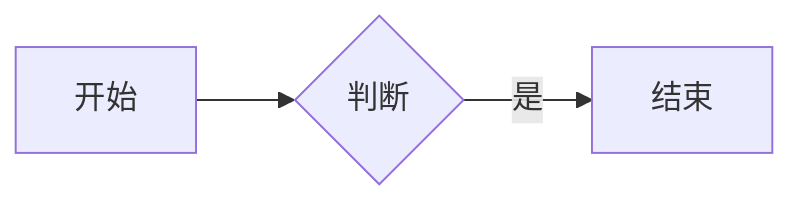

## mermaid 代码块写法

## mermaid 标签写法


sequenceDiagram
  participant U as 用户
  participant S as 服务
  U->>S: 请求
  S-->>U: 响应


## chartjs 标签写法


{
  "type": "bar",
  "data": {
    "labels": ["一", "二", "三"],
    "datasets": [{ "label": "测试", "data": [3, 7, 5] }]
  }
}

